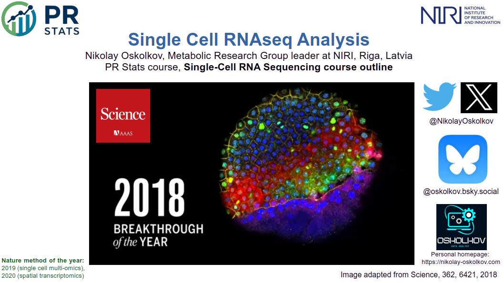

# Single Cell RNAseq Analysis

## Instructor

- Dr. Nikolay Oskolkov, Group Leader (PI) at NIRI, Riga, Latvia

## Course overview
The study of gene expression at the resolution of individual cells using single-cell RNA sequencing (scRNA-seq) has revolutionized modern biology, with wide-ranging applications in developmental biology, immunology, cancer research, and drug discovery. However, the analysis of scRNA-seq data poses significant computational and statistical challenges, particularly when moving from raw count matrices to biologically meaningful inferences about cellular identity, state, and heterogeneity. In this course, we will explore the key challenges and analytical methods in single-cell transcriptomics, focusing on a comprehensive understanding and practical implementation of the computational workflow spanning quality control, normalization, dimensionality reduction, clustering, and multi-modal integration using the Seurat ecosystem and related tools.

## Target audience and assumed background
We assume some basic awareness of UNIX environment, as well as at least beginner level of R and / or Python programming.

## Learning outcomes
By completing this course, you will:

- Understand the fundamentals of single-cell RNA sequencing technologies and the sources of biological and technical variation in scRNA-seq data
- Have an overview of bioinformatic tools and best practices for preprocessing, quality control, and normalization within the Seurat ecosystem
- Be able to perform quality control, normalization, batch correction, and dimensionality reduction on your own scRNA-seq datasets
- Know the key challenges, approaches, and solutions in cell clustering, cell type annotation, and deconvolution analysis
- Be able to carry out PCA, tSNE, and UMAP, as well as hierarchical, partitioning, density-, and graph-based clustering to address your specific research question
- Be able to interpret clustering and integration results and choose the right analytical framework for horizontal and vertical integration of scRNA-seq and multi-omics data 

---

# Schedule

## Before the course

| Time   | Activity                                                                                           |Link                                                                                                            |
|--------|----------------------------------------------------------------------------------------------------|------------------------------------------------------------------------------------------------------------------------------------------|
| ~ 1 h  | Recorded talk: lecture on dimensionality reduction of scRNAseq data with Nikolay Oskolkov          | [Video](https://www.youtube.com/watch?v=X6zQ0a0da8I)                                                                                                |
| ~ 1 h  | Recorded talk: lecture on integration of scRNAseq data with Nikolay Oskolkov                       | [Video](https://www.youtube.com/watch?v=a-vzYSYA9mg)                                                                                                    |
| ~ 2 h  | High-throughput muscle fiber typing from RNA sequencing data                                       | [PDF](https://github.com/NikolayOskolkov/SBW2022/blob/main/articles/13395_2022_Article_299.pdf)                                                                                   |
| ~ 2 h  | Subclasses of breast cancer-associated fibroblasts revealed by single cell RNA sequencing          | [PDF](https://github.com/NikolayOskolkov/SBW2022/blob/main/articles/41467_2018_Article_7582.pdf)                                                                                   |
| ~ 1 h  | Useful reading: deep learning applications in single cell biology and RNAseq analysis              | [Blog](https://medium.com/data-science/deep-learning-for-single-cell-biology-935d45064438?sk=f5407fc10c171898de1ed9b4d5833914)                                                                          |
| ~ 1 h  | In case needed: Recap on basic Unix commands                                                       | [Lab](https://github.com/NikolayOskolkov/PopGen_PopStructure/blob/main/practicals/command-line-basics.md)                                                                                                    |

## Day 1: 3 pm - 9 pm Swedish time

| Time           | Activity                                                                                   |Link                                                                                                            |
|----------------|--------------------------------------------------------------------------------------------|------------------------------------------------------------------------------------------------------------------------------------------|
| 15.00 - 16.00  | Course outline and practical information, introductions of participants                    | [Slides](https://github.com/NikolayOskolkov/SBW2022/blob/main/slides/Day1/course_outline.pdf)                                                                                           |
| 16.00 - 17.30  | Introduction to single-cell RNA-seq technologies and computational workflows               | [Slides](https://github.com/NikolayOskolkov/SBW2022/blob/main/slides/Day1/SungleCell_PRStats_Oskolkov_session1.pdf)                                                                                       |
| 17.30 - 18.30  | Break                                                                                      |                                                                                                                |
| 18.30 - 19.00  | Probabilistic variant calling from low-coverage genomics data with ANGSD                   | [Slides](https://github.com/NikolayOskolkov/PopGen_PopStructure/blob/main/slides/Day1/ANGSD.pdf)                                                                                                    |
| 19.00 - 20.30  | Practical: Seurat workflow and quality control                                             | [Lab](https://github.com/NikolayOskolkov/PopGen_PopStructure/blob/main/practicals/Day1/QC_Alignment_Colab.ipynb)                                                                                     |
| 20.30 - 21.00  | Questions and discussion                                                                   |

## Day 2: 3 pm - 9 pm Swedish time

| Time           | Activity                                                                                   |Link                                                                                                            |
|----------------|--------------------------------------------------------------------------------------------|------------------------------------------------------------------------------------------------------------------------------------------|
| 15.00 - 16.00  | Bonus material: introduction to imputation and genetic imputation with IMPUTE2             | [Slides](https://github.com/NikolayOskolkov/PopGen_PopStructure/blob/main/slides/Day2/imputation.pdf)                                                                                               |
| 15.00 - 16.00  | Principal Components Analysis (PCA) for population genomics applications                   | [Slides](https://github.com/NikolayOskolkov/PopGen_PopStructure/blob/main/slides/Day2/PCA_PopGen.pdf)                                                                                               |
| 16.00 - 17.30  | Nonlinear dimensionality reduction with tSNE and UMAP for population genomics applications | [Slides](https://github.com/NikolayOskolkov/PopGen_PopStructure/blob/main/slides/Day2/DimReduct_PopGen.pdf)                                                                                         |
| 17.30 - 18.30  | Break                                                                                      |                                                                                                                |
| 18.30 - 19.30  | Practical: coding PCA and Multi-Dimensional Scaling (MDS) from scratch                     | [Lab](https://html-preview.github.io/?url=https://github.com/NikolayOskolkov/PopGen_PopStructure/blob/main/practicals/Day2/pca_mds_toy_example.html)                                                                     |
| 18.30 - 19.30  | Practical: practicing PCA, MDS, tSNE and UMAP                                              | [Lab](https://html-preview.github.io/?url=https://github.com/NikolayOskolkov/PopGen_PopStructure/blob/main/practicals/Day2/Dimension_Reduction_tutorial.html)                                                            |
| 19.30 - 20.30  | Practical: horseshoue effect in PCA, coding from scratch and exploring block structure     | [Lab](https://html-preview.github.io/?url=https://github.com/NikolayOskolkov/PopGen_PopStructure/blob/main/practicals/Day2/WhyPCALooksTriangular.html)                                                                   |
| 20.30 - 21.00  | Questions and discussion                                                                   |

## Day 3: 3 pm - 9 pm Swedish time

| Time           | Activity                                                                                   |Link                                                                                                            |
|----------------|--------------------------------------------------------------------------------------------|------------------------------------------------------------------------------------------------------------------------------------------|
| 15.00 - 16.00  | Introduction to clustering algorithms: hierarchical and partition clustering               | [Slides](https://github.com/NikolayOskolkov/PopGen_PopStructure/blob/main/slides/Day3/IntroClustering.pdf)                                                                                          |
| 16.00 - 17.30  | Admixture analysis and admixture inference from low-coverage data with NGSadmix            | [Slides](https://github.com/NikolayOskolkov/PopGen_PopStructure/blob/main/slides/Day3/Admixture.pdf)                                                                                                |
| 17.30 - 18.30  | Break                                                                                      |                                                                                                                |
| 18.30 - 19.30  | Practical: admixture inference from low-coverage data with NGSadmix                        | [Lab](https://html-preview.github.io/?url=https://github.com/NikolayOskolkov/PopGen_PopStructure/blob/main/practicals/Day1/ANGSD_Lab_GoogleColab.html)                                                                   |
| 19.30 - 20.30  | Practical: maximum likelihood admixture inference with Admixture tool                      | [Lab](https://html-preview.github.io/?url=https://github.com/NikolayOskolkov/PopGen_PopStructure/blob/main/practicals/Day3/ADMIXTURE_Colab.html)                                                                         |
| 19.30 - 20.30  | Practical: practicing hierarchical, partitioning and density-based clustering              | [Lab](https://html-preview.github.io/?url=https://github.com/NikolayOskolkov/PopGen_PopStructure/blob/main/practicals/Day3/Clustering_Lab.html)                                                                          |
| 19.30 - 20.30  | Practical: practicing Gaussian Mixture Model (GMM) underlying STRUCTURE software           | [Lab](https://html-preview.github.io/?url=https://github.com/NikolayOskolkov/PopGen_PopStructure/blob/main/practicals/Day3/GMM_FromScratch.html)                                                                         |
| 20.30 - 21.00  | Questions and discussion                                                                   |

## Day 4: 3 pm - 9 pm Swedish time

| Time           | Activity                                                                                   |Link                                                                                                            |
|----------------|--------------------------------------------------------------------------------------------|------------------------------------------------------------------------------------------------------------------------------------------|
| 15.00 - 16.00  | Phylogenetic analysis: genetic and evolutionary distance, phylogenetic tree construction   | [Slides](https://github.com/NikolayOskolkov/PopGen_PopStructure/blob/main/slides/Day3/PhylogeneticAnalysis.pdf)                                                                                     |
| 16.00 - 16.30  | Introduction to selection and drift of allele frequencies: Wright-Fisher model             | [Slides](https://github.com/NikolayOskolkov/PopGen_PopStructure/blob/main/slides/Day4/selection.pdf)                                                                                                |
| 16.30 - 17.30  | Practical: practicing natural selection vs genetic drift Wright-Fisher model               | [Lab](https://github.com/NikolayOskolkov/PopGen_PopStructure/blob/main/practicals/Day4/Selection_vs_Drift.ipynb)                                                                                     |
| 17.30 - 18.30  | Break                                                                                      |                                                                                                                |
| 18.30 - 19.30  | Nucleotide diversity, population differentiation, Tajima's D and Fst selection analyses    | [Slides](https://github.com/NikolayOskolkov/PopGen_PopStructure/blob/main/slides/Day4/F_statistics.pdf)                                                                                             |
| 19.30 - 20.30  | Practical: computation of Fst from low-coverage data within ANGSD workflow                 | [Lab](https://html-preview.github.io/?url=https://github.com/NikolayOskolkov/PopGen_PopStructure/blob/main/practicals/Day4/Fst_Colab.html)                                                                               |
| 19.30 - 20.30  | Practical: computation of F2 statistics and clustering using AADR dataset                  | [Lab](https://html-preview.github.io/?url=https://github.com/NikolayOskolkov/PopGen_PopStructure/blob/main/practicals/Day4/F2_statistics_AADR_heatmap.html)                                                              |
| 20.30 - 21.00  | Questions and discussion                                                                   |

## Day 5: 3 pm - 9 pm Swedish time

| Time           | Activity                                                                                   |Link                                                                                                            |
|----------------|--------------------------------------------------------------------------------------------|------------------------------------------------------------------------------------------------------------------------------------------|
| 15.00 - 16.00  | Practical: computation of F3 statistics for an Unknown population in AADR dataset          | [Lab](https://html-preview.github.io/?url=https://github.com/NikolayOskolkov/PopGen_PopStructure/blob/main/practicals/Day5/F3_outgroup_AADR.html)                                                                        |
| 16.00 - 17.30  | Introgression analysis with D-statistic and applications to ancient DNA                    | [Slides](https://github.com/NikolayOskolkov/PopGen_PopStructure/blob/main/slides/Day5/Dstat.pdf)                                                                                                    |
| 17.30 - 18.30  | Break                                                                                      |                                                                                                                |
| 18.30 - 19.30  | Practical: computation of D-statistic on Nenderthal and modern human genomics data         | [Lab](https://github.com/NikolayOskolkov/PopGen_PopStructure/blob/main/practicals/Day5/Dstat_ABBA_BABA_Colab.ipynb)                                                                                  |
| 19.30 - 20.30  | Practical: D-statistic, F4 and F4-ratio computations via admixR software                   | [Lab](https://bodkan.net/admixr/articles/vignette-01-tutorial.html)                                                                                  |
| 20.30 - 21.00  | Questions and discussion                                                                   |

